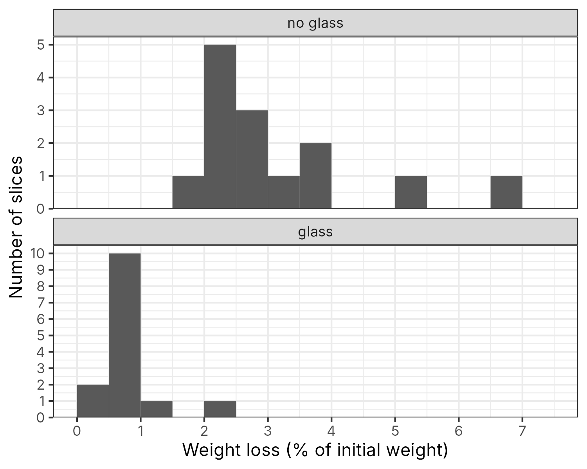
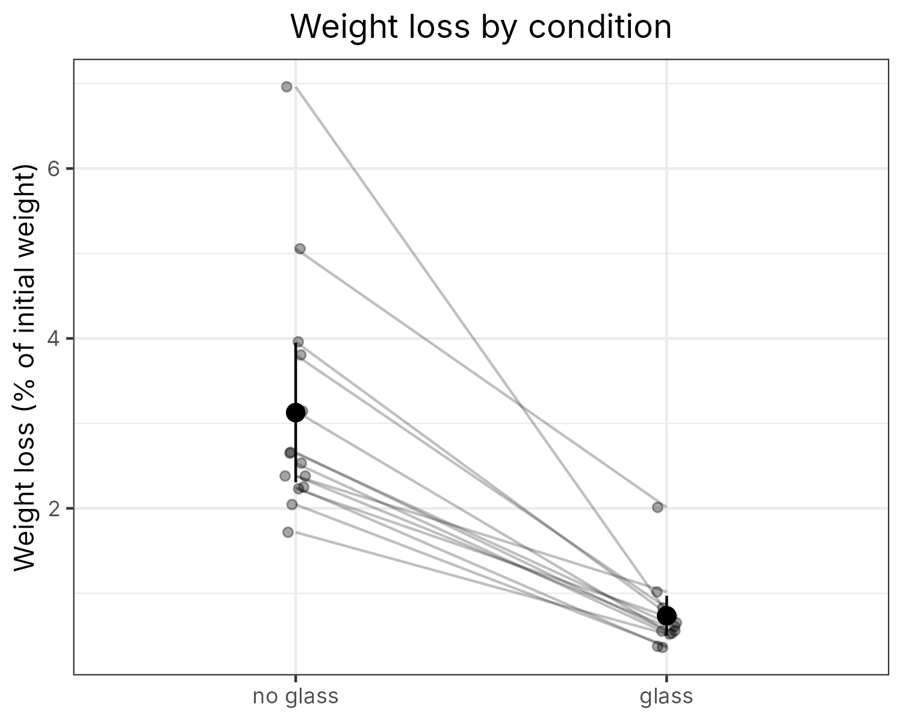

# Motivation and Hypothesis

According to popular belief and online kitchen guides, a glass of water in the microwave reduces moisture loss when defrosting bread, either by adding humidity or by absorbing microwave energy. I found no existing prior evidence that it works. The central hypothesis is that the percentage of weight lost differs between frozen sourdough slices microwaved with a glass of water and those microwaved without it, at the same power and time. I expect lower weight loss with the glass, but the test is two-sided, to be more conservative.

# Empirical Strategy

## Unit of analysis

The units are 28 frozen slices of Trader Joe's San Francisco-style sourdough from two packs that were bought together and frozen next to each other for 24 hours. This is two fewer units than the suggested 30, since each pack had only 14 usable slices. Importantly, slices are asymmetrical within a pack, but similar in expectation to the same-position slice of the other pack. So, after removing the initial heel, I numbered each pack's slices from left to right and paired same-numbered slices, giving 14 blocks.

## Randomization procedure

Within each block, a physical coin flip decided which slice was treated (tails: pack A; heads: pack B), and a second decided whether the treated or the untreated slice went first. The flips were made after registration and before the session. The treatment is a glass with 140 g of room-temperature water next to the slice, replaced after every run, and controls had no glass. Both conditions used default power for 35 seconds, chosen in an informal pilot (without a glass) to properly defrost a mid-sized slice. All slices were microwaved in a single session of approx. two hours.

A research assistant (RA), in another room and blind to each assignment, weighed every slice to 0.1 g before and after microwaving. The outcome is percentage weight loss, −[(post-weight − pre-weight) / pre-weight × 100]. The pre-weight is the only covariate: under the null that it does not predict treatment, 43% of the possible assignments give an F-statistic at least as large as the observed one (p = 0.43), so there is no evidence of imbalance.

# Core Assumptions

- **Random assignment:** coin flips within blocks (probability 0.5), made and recorded by me, so a violation is unlikely.
- **Non-interference:** steam or heat from one microwave run could affect the next slice, so I left the microwave open between slices, used fresh water from the same container, microwaved one slice at a time and randomized which went first to minimize possible violations of this assumption.
- **Excludability:** since I knew the assignment, small biased decisions when reading the scale were possible, so the RA was blind and the scale, plate and handling were identical across conditions, although a warmer slice could reveal its condition (imperfect blinding).
- **Compliance and attrition:** I delivered the treatment myself and weighed every slice, so neither was a concern.

# Results

Figure 1 shows weight loss by condition. Control slices lost 3.13% on average (SD 1.42) and glass slices 0.73% (SD 0.41).

```{r fig1, echo=FALSE, out.width="46%", fig.align="center", fig.cap="Percentage weight loss by condition (each panel has its own y-axis)."}

```

The ATE is the mean of the 14 within-block differences in percentage weight loss: −2.39. On average, adding the glass reduced weight loss by 2.39 percentage points at 35 seconds and default power (Table 1). The naive estimate is identical, since every block has one slice per condition, but its standard error, which combines the two groups' standard deviations (0.41 and 1.42), is 0.39. Blocking reduces it to 0.34, the standard deviation of the 14 block differences (1.26) divided by √14. Adjusting for pre-weight gives −2.19.

\needspace{9\baselineskip}

**Table 1.** Effect of a glass of water on percentage weight loss

| | (1) Naive | (2) Block fixed effects | (3) + Pre-weight |
|:---|:---:|:---:|:---:|
| Glass of water | −2.392\*\*\* (0.395) | −2.392\*\*\* (0.337) | −2.186\*\*\* (0.263) |
| Block fixed effects | No | Yes | Yes |
| Observations | 28 | 28 | 28 |
| R² | 0.585 | 0.849 | 0.920 |

\small OLS standard errors in parentheses. \*\*\* p < 0.01. Randomization inference: ATE −2.39, SE 0.33, 95\% CI (−2.96, −1.83), two-sided p = 0.0002.\normalsize

Randomization inference tests the sharp null of no effect on any slice. I sampled 10,000 of the 16,384 possible within-block assignments. Only 2 produced an estimate at least as large in absolute value as the observed one (two-sided p = 0.0002). In all 14 blocks, the glass slice lost less than its control. Setting each slice's effect equal to the estimate, the randomization distribution has a standard deviation of 0.33 (the standard error) and a 95% interval of (−2.96, −1.83), which would contain the true ATE in 95% of repeated experiments.

Figure 2 shows each slice, each condition's mean with its 95% confidence interval, and lines joining the two slices of each block (Coppock 2021). I forgot to include this figure in the pre-analysis plan.

```{r fig2, echo=FALSE, out.width="46%", fig.align="center", fig.cap="Percentage weight loss by condition, with block pairs joined."}

```

# Conclusion

Putting a glass of water in the microwave reduced weight loss by 2.39 percentage points on average. Statistically, it is a significant effect, and substantively, it is also a large effect: 1.7 standard deviations of the control group's weight loss. However, this design cannot say whether the loss is due to the glass adding humidity, absorbing microwave energy, or both. Since neither humidity nor temperature was measured, glass slices may simply be less defrosted. Future work could measure both, add a third treatment status of glass with no water, and test other breads.


\newpage

# Appendix

## Data

One row per slice. Glass: 1 if microwaved with the glass of water, 0 if not. Order: 1 if microwaved first within its block. The data (`bread_data.csv`) and the R code are on GitHub: <https://github.com/hugovallecillo/Practicum_POLSGU4725>.

| slice_id | block | pack | glass (1 = yes) | order | pre-weight (g) | post-weight (g) | weight loss (%) |
| --- | --- | --- | --- | --- | --- | --- | --- |
| A01 | 1 | A | 1 | 1 | 34.8 | 34.1 | 2.01 |
| B01 | 1 | B | 0 | 2 | 35.6 | 33.8 | 5.06 |
| A02 | 2 | A | 1 | 2 | 38.5 | 38.2 | 0.78 |
| B02 | 2 | B | 0 | 1 | 31.6 | 29.4 | 6.96 |
| A03 | 3 | A | 0 | 2 | 40.4 | 38.8 | 3.96 |
| B03 | 3 | B | 1 | 1 | 39.3 | 39.0 | 0.76 |
| A04 | 4 | A | 1 | 2 | 48.3 | 47.9 | 0.83 |
| B04 | 4 | B | 0 | 1 | 47.3 | 45.5 | 3.81 |
| A05 | 5 | A | 0 | 2 | 45.3 | 44.1 | 2.65 |
| B05 | 5 | B | 1 | 1 | 46.0 | 45.7 | 0.65 |
| A06 | 6 | A | 0 | 1 | 50.4 | 49.2 | 2.38 |
| B06 | 6 | B | 1 | 2 | 49.2 | 48.7 | 1.02 |
| A07 | 7 | A | 1 | 1 | 53.2 | 53.0 | 0.38 |
| B07 | 7 | B | 0 | 2 | 53.8 | 52.7 | 2.04 |
| A08 | 8 | A | 0 | 1 | 53.8 | 52.6 | 2.23 |
| B08 | 8 | B | 1 | 2 | 55.1 | 54.7 | 0.73 |
| A09 | 9 | A | 1 | 2 | 49.1 | 48.8 | 0.61 |
| B09 | 9 | B | 0 | 1 | 50.4 | 49.2 | 2.38 |
| A10 | 10 | A | 0 | 1 | 55.3 | 53.9 | 2.53 |
| B10 | 10 | B | 1 | 2 | 56.7 | 56.4 | 0.53 |
| A11 | 11 | A | 0 | 1 | 50.9 | 49.3 | 3.14 |
| B11 | 11 | B | 1 | 2 | 54.1 | 53.8 | 0.55 |
| A12 | 12 | A | 1 | 1 | 57.7 | 57.4 | 0.52 |
| B12 | 12 | B | 0 | 2 | 58.2 | 57.2 | 1.72 |
| A13 | 13 | A | 1 | 2 | 55.1 | 54.9 | 0.36 |
| B13 | 13 | B | 0 | 1 | 53.3 | 52.1 | 2.25 |
| A14 | 14 | A | 1 | 1 | 53.6 | 53.3 | 0.56 |
| B14 | 14 | B | 0 | 2 | 56.4 | 54.9 | 2.66 |

## R code

```{r code-listing, eval=FALSE, echo=TRUE, size="footnotesize"}
# ==============================================================================
# Analysis code: does a glass of water in the microwave reduce moisture
# loss when defrosting sourdough bread?
#
# Design: small-scale randomized experiment, 14 blocks of two frozen sourdough
# slices (same-numbered slice from pack A and pack B), one treated (microwaved
# with a glass of 140 g of room-temperature water) and one control (no glass),
# 35 seconds at default power. Outcome: percentage weight loss.
#
# This script does three things, in this order:
#   1. Randomization (coin flips -> assignment)
#   2. Cleaning and derived variables
#   3. Main analysis (estimate, randomization inference, secondary models, figures)
#
# FINAL VERSION, run on the real data. It is the registered script
# (bread_analysis_code.R) with these changes made after data collection:
#   - the real coin flips replace the placeholders in section 2,
#   - bread_data.csv holds the measured weights (columns slice_id, pre_weight,
#     post_weight; slice_id = pack letter + two-digit block, e.g. A07),
#   - section 8 adds a one-row summary table of the main result (results_table),
#   - Figure 1 (section 10a) is redrawn with 0.5-point bars and a whole-number
#     y-axis, and is saved to a file,
#   - section 11 adds a Coppock-style figure for the write-up, which was NOT in
#     the pre-analysis plan.
# The estimates, tests and models are unchanged.
# ==============================================================================

# ==========================================================================
# 0. PACKAGES
# ==========================================================================
# Install any missing packages (only needed the first time)
pkgs <- c("tidyverse", "stargazer")
to_install <- pkgs[!pkgs %in% rownames(installed.packages())]
if (length(to_install) > 0) install.packages(to_install)

# 'ri' is no longer on CRAN, so it is installed from the read-only CRAN mirror
# on GitHub.
if (!"ri" %in% rownames(installed.packages())) {
  install.packages("https://codeload.github.com/cran/ri/tar.gz/refs/heads/master",
                   repos = NULL, type = "source")
}

library(tidyverse)   # dplyr, tidyr, ggplot2, readr, tibble
library(ri)          # randomization inference
library(stargazer)   # regression tables


# ==========================================================================
# 1. FIXED PARAMETERS
# ==========================================================================
n_blocks     <- 14
T_sec        <- 35          # microwave time (seconds), same in both arms
power        <- "default"   # microwave setting, same in both arms
post_delay_s <- 10          # post-weight taken this many seconds after the microwave stops


# ==========================================================================
# 2. RANDOMIZATION (coin flips -> assignment)
# ==========================================================================
# PHYSICAL COIN FLIPS, in block order (H = heads, T = tails).
# (Recovered from the recorded treatment and order of each block.)
# flip 1: T means the pack A slice is treated
# flip 2: T means the treated slice is microwaved first
flip1_raw <- c("T","T","H","T","H","H","T","H","T","H","H","T","T","T")
flip2_raw <- c("T","H","T","H","T","H","T","H","H","H","H","T","H","T")
using_placeholder_flips <- FALSE  # real flips entered

stopifnot(length(flip1_raw) == n_blocks, length(flip2_raw) == n_blocks,
          all(c(flip1_raw, flip2_raw) %in% c("H", "T")))

blocks <- tibble(
  block = 1:n_blocks,
  flip1 = ifelse(flip1_raw == "T", "tails", "heads"),
  flip2 = ifelse(flip2_raw == "T", "tails", "heads")
)
using_placeholder_flips

assignment <- blocks %>%
  crossing(pack = c("A", "B")) %>%
  mutate(
    treat = as.integer((flip1 == "tails" & pack == "A") |
                       (flip1 == "heads" & pack == "B")),
    treated_first = as.integer(flip2 == "tails"),
    order = case_when(
      treat == 1 & treated_first == 1 ~ 1L,  # treated slice goes first
      treat == 0 & treated_first == 0 ~ 1L,  # control slice goes first
      TRUE                            ~ 2L
    ),
    slice_id = paste0(pack, sprintf("%02d", block))
  ) %>%
  arrange(block, pack)

# Checks that the procedure was followed
stopifnot(
  nrow(assignment) == 2 * n_blocks,
  all(tapply(assignment$treat, assignment$block, sum) == 1),   # one treated per block
  all(tapply(assignment$order, assignment$block, sum) == 3)    # one first, one second
)
table(assignment$treat)
table(assignment$pack, assignment$treat)
table(assignment$treated_first[assignment$treat == 1])


# ==========================================================================
# 3. SPREADSHEETS (optional; run once if wanted)
# ==========================================================================
## write_csv(assignment, "assignment_researcher.csv")
## 
## assignment %>%
##   arrange(block, order) %>%
##   transmute(block, order, slice_id, pack,
##             pre_weight = NA_real_, post_weight = NA_real_) %>%
##   write_csv("sheet_for_RA.csv")


# ==========================================================================
# 4. DATA
# ==========================================================================
if (file.exists("bread_data.csv") && using_placeholder_flips) {
  stop("bread_data.csv exists but the flips in section 2 are still placeholders. Enter the real flips and set using_placeholder_flips <- FALSE.")
}

if (file.exists("bread_data.csv")) {
  using_simulated <- FALSE
  raw <- read_csv("bread_data.csv") %>% left_join(assignment, by = "slice_id")
} else {
  using_simulated <- TRUE
  set.seed(2026)
  block_size <- rnorm(n_blocks, mean = 42, sd = 5)
  block_eff  <- rnorm(n_blocks, mean = 0, sd = 0.7)
  raw <- assignment %>%
    mutate(
      pre_weight  = round(block_size[block] + rnorm(n(), 0, 0.8), 1),
      true_loss   = 3 + block_eff[block] - 0.8 * treat + rnorm(n(), 0, 0.5),
      post_weight = round(pre_weight * (1 - true_loss / 100), 1)
    ) %>%
    select(-true_loss)
}
using_simulated


# ==========================================================================
# 5. CLEANING AND DERIVED VARIABLES
# ==========================================================================
dat <- raw %>%
  mutate(
    loss_pct  = (pre_weight - post_weight) / pre_weight * 100,
    condition = factor(ifelse(treat == 1, "glass", "no glass"),
                       levels = c("no glass", "glass"))
  )

# Block-level data: one row per block, treated minus control
bd <- dat %>%
  group_by(block) %>%
  summarise(
    d_pct         = loss_pct[treat == 1] - loss_pct[treat == 0],
    pre_diff      = pre_weight[treat == 1] - pre_weight[treat == 0],
    treated_first = order[treat == 1] == 1,
    .groups = "drop"
  )
n <- nrow(bd)
n


# ==========================================================================
# 6. RANDOMIZATION CHECKS (randomization inference)
# ==========================================================================
Z        <- dat$treat
Y        <- dat$loss_pct
blockvar <- dat$block

set.seed(1234567)                                  # so the sampled assignments are reproducible
prob  <- genprobexact(Z, blockvar)                 # probability of treatment (0.5 in every block)
perms <- genperms(Z, blockvar, maxiter = 10000)    # possible assignments, within blocks
dim(perms)                                         # rows = slices, columns = assignments

# F-statistic in the realized data and under every sampled assignment
Fstat  <- summary(lm(treat ~ pre_weight, data = dat))$fstatistic[1]
Fstore <- apply(perms, 2, function(z) summary(lm(z ~ pre_weight, data = dat))$fstatistic[1])
mean(Fstore >= Fstat)   # randomization inference p-value

# Descriptive balance: pre-weight by arm, order split, and pack split
dat %>% group_by(condition) %>% summarise(mean_pre_weight = mean(pre_weight))
table(bd$treated_first)
table(dat$pack, dat$treat)


# ==========================================================================
# 7. MAIN ANALYSIS: ESTIMATE
# ==========================================================================
ate <- mean(bd$d_pct)   # mean of the 14 within-block differences
ate


# ==========================================================================
# 8. RANDOMIZATION INFERENCE (sharp null, two-sided)
# ==========================================================================
ate_ri <- estate(Y, Z, prob = prob)               # difference in means

# Sharp null of no effect: potential outcomes are the same under both conditions
Ys_null   <- genouts(Y, Z, ate = 0)
dist_null <- gendist(Ys_null, perms, prob = prob, HT = FALSE)
p_two_sided <- mean(abs(dist_null) >= abs(ate_ri) - 1e-12)

# Confidence interval: distribution of the estimates if the true effect equals the estimate
Ys_est   <- genouts(Y, Z, ate_ri)
dist_est <- gendist(Ys_est, perms, prob = prob, HT = FALSE)
disp     <- dispdist(dist_est, ate_ri, display.plot = FALSE)
ci_ri    <- disp$quantile   # 95% confidence interval
se_ri    <- disp$sd         # standard error of the randomization distribution

c(ATE = ate_ri, SE = se_ri, p_two_sided = p_two_sided)
ci_ri

# Summary of the main result (randomization inference)
results_table <- tibble(
  ATE         = as.numeric(ate_ri),
  SE          = se_ri,
  CI_low      = unname(ci_ri[1]),
  CI_high     = unname(ci_ri[2]),
  p_two_sided = p_two_sided
) %>% mutate(across(everything(), ~ round(.x, 4)))
results_table


# ==========================================================================
# 9. SECONDARY MODELS
# ==========================================================================
m1 <- lm(loss_pct ~ treat, data = dat)                              # naive difference in means
m2 <- lm(loss_pct ~ treat + factor(block), data = dat)              # block fixed effects (primary)
m3 <- lm(loss_pct ~ treat + factor(block) + pre_weight, data = dat) # + pre-weight

stargazer(m1, m2, m3, header = FALSE, type = "text",
          keep = "treat", covariate.labels = "Glass of water",
          dep.var.labels = "Weight loss (%)",
          title = "Effect of a glass of water on weight loss when microwaving frozen sourdough",
          omit.stat = c("f", "ser"),
          add.lines = list(c("Block fixed effects", "No", "Yes", "Yes")))


# ==========================================================================
# 10a. FIGURE: distribution of outcomes by condition
# ==========================================================================
fig1 <- ggplot(dat, aes(loss_pct)) +
  geom_histogram(binwidth = 0.5, boundary = 0, closed = "left") +   # bars of 0.5 percentage points
  facet_wrap(~ condition, ncol = 1, scales = "free_y") +
  scale_x_continuous(breaks = 0:7, limits = c(0, 7.5)) +
  scale_y_continuous(breaks = function(lims) seq(0, floor(lims[2]), by = 1),
                     expand = expansion(mult = c(0, 0.05))) +
  theme_bw() +
  labs(x = "Weight loss (% of initial weight)", y = "Number of slices")
fig1
ggsave("figure1_distribution_by_condition.png", fig1, width = 5, height = 4, dpi = 300)


# ==========================================================================
# 10b. FIGURE: distribution of estimates under the sharp null
# ==========================================================================
ggplot(tibble(est = as.numeric(dist_null)), aes(est)) +
  geom_histogram(bins = 40) +
  geom_vline(xintercept = ate_ri, colour = "red", linetype = "dashed") +
  theme_bw() +
  labs(x = "Estimated ATE under the sharp null", y = "Assignments")


# ==========================================================================
# 11. FIGURE FOR THE WRITE-UP: Coppock-style graph (NOT in the pre-analysis plan)
# ==========================================================================
# Individual slices (points), group means with 95% confidence intervals, and
# lines joining the two slices of each block, so the design (blocking) is visible.
summary_loss <- dat %>%
  group_by(condition) %>%
  summarise(mean_loss = mean(loss_pct),
            se = sd(loss_pct) / sqrt(n()),
            lo = mean_loss - qt(0.975, n() - 1) * se,
            hi = mean_loss + qt(0.975, n() - 1) * se,
            .groups = "drop")
summary_loss

fig2 <- ggplot(summary_loss, aes(condition, mean_loss)) +
  geom_line(data = dat, aes(y = loss_pct, group = block), alpha = 0.25) +
  geom_point(data = dat, aes(y = loss_pct), alpha = 0.35,
             position = position_jitter(width = 0.03, height = 0)) +
  geom_point(size = 3) +
  geom_errorbar(aes(ymin = lo, ymax = hi), width = 0) +
  theme_bw() +
  theme(axis.title.x = element_blank(),
        plot.title = element_text(hjust = 0.5)) +
  ylab("Weight loss (% of initial weight)") +
  ggtitle("Weight loss by condition")
fig2
ggsave("figure2_coppock_style.png", fig2, width = 5, height = 4, dpi = 300)
```

## Reference

Coppock, A. 2021. "Visualize As You Randomize: Design-Based Statistical Graphs for Randomized Experiments." In *Advances in Experimental Political Science*, edited by J. N. Druckman and D. P. Green, 320--336. New York: Cambridge University Press.
